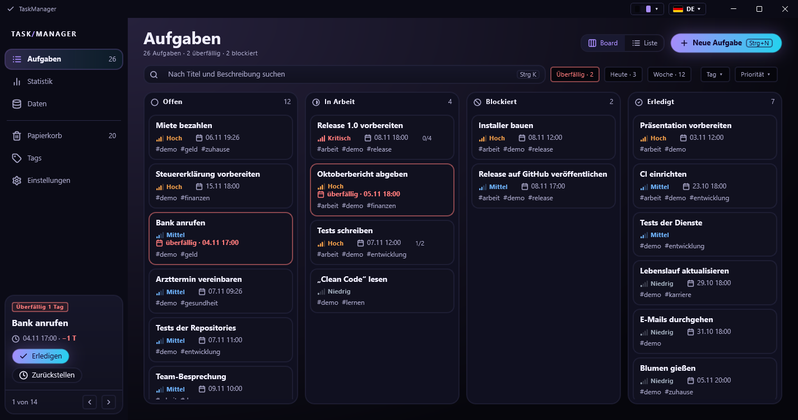
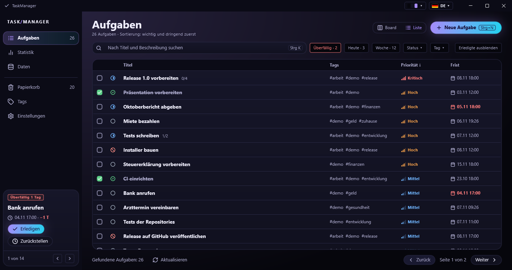
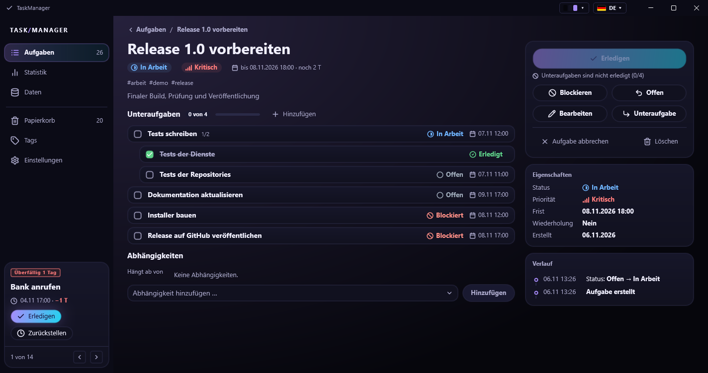
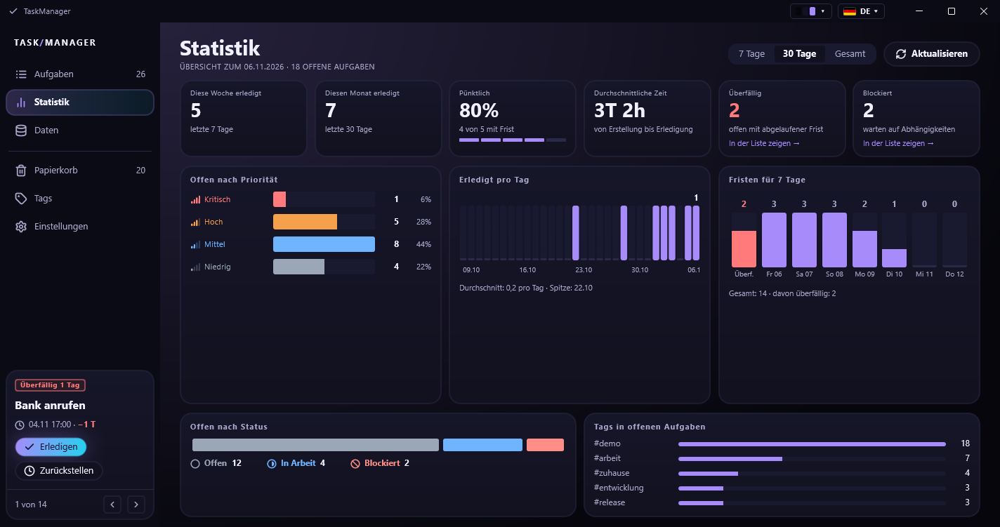
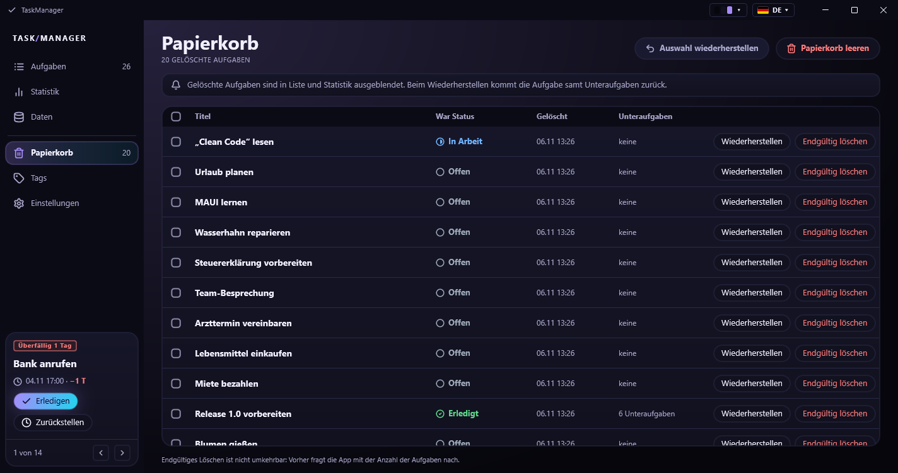
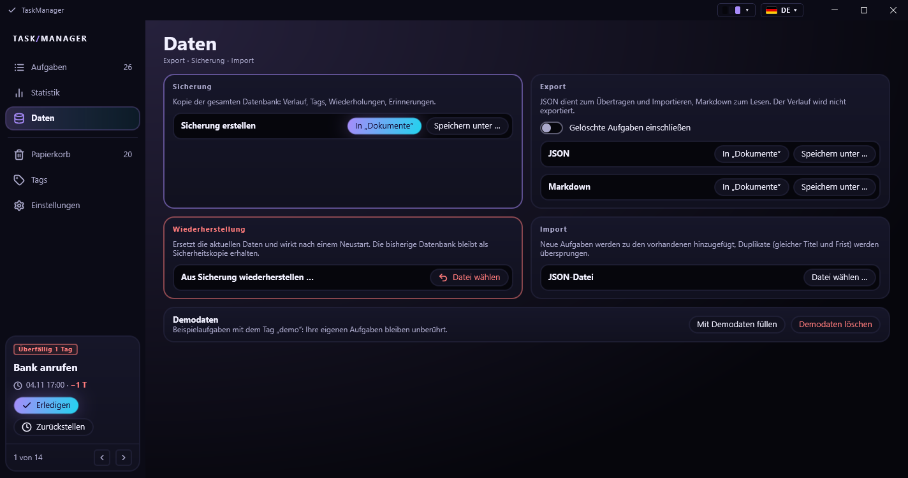
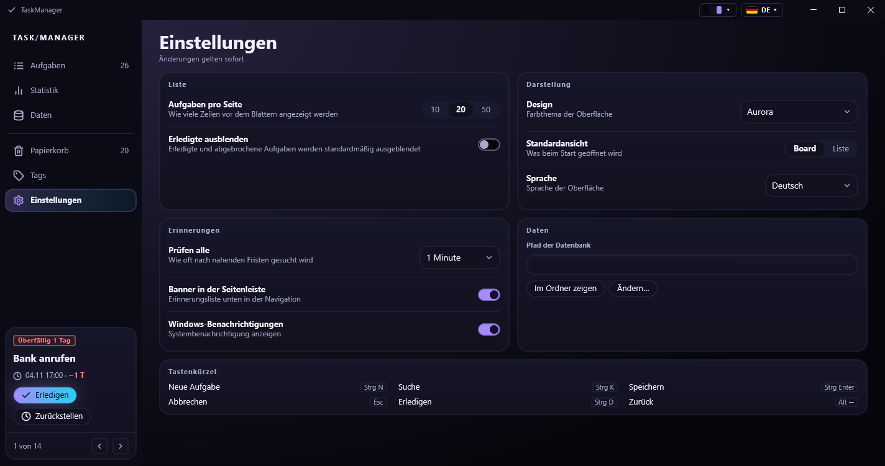

# TaskManager

[](https://github.com/BigJellyDog/TaskManager/actions/workflows/build.yml)

[English](README.md) · **Deutsch**

Eine persönliche Aufgabenverwaltung für Windows, entwickelt mit **C#, .NET 10 und .NET MAUI**.
Alle Daten liegen in einer lokalen SQLite-Datei: kein Konto, kein Server, keine Cloud.



## Das Wichtigste

- **Board und Liste** mit Suche, Schnellfiltern (überfällig / heute / diese Woche), Filter nach Status, Tag und
  Priorität, Sortierung nach Wichtigkeit und Dringlichkeit sowie Seitenwechsel.
- **Unteraufgaben** bis zu drei Ebenen tief mit Fortschrittsbalken und **Abhängigkeiten** zwischen Aufgaben:
  Eine Aufgabe, die auf eine andere wartet, ist blockiert; Zyklen werden abgelehnt.
- **Ein strenger Statusablauf** (offen, in Arbeit, blockiert, erledigt, abgebrochen) mit Wiedereröffnen und
  einem vollständigen **Verlauf** aller Änderungen auf der Aufgabenkarte.
- **Wiederkehrende Aufgaben** (täglich, wöchentlich, monatlich, jährlich; alle N, gewählte Wochentage), die
  nach dem Erledigen oder nach dem Kalender wiederkehren, auch für Tage, an denen die App geschlossen war.
- **Erinnerungen** 24 Stunden und 1 Stunde vor der Frist sowie bei Überfälligkeit: die dringendste in der
  Seitenleiste mit *Erledigen* und *Zurückstellen*, dazu eine optionale Windows-Benachrichtigung. Das
  Prüfintervall ist einstellbar oder abschaltbar.
- **Papierkorb** statt Löschen: Wiederherstellen samt Unteraufgaben, endgültig löschen, leeren, alle auswählen.
- **Statistik** für 7 Tage, 30 Tage oder die gesamte Zeit: erledigt pro Tag, offene Aufgaben nach Priorität und
  Status, Pünktlichkeit, durchschnittliche Bearbeitungszeit, Fristen der nächsten 7 Tage, häufigste Tags.
- **Ihre Daten gehören Ihnen**: Export als JSON und Markdown, JSON-Import mit ausführlichem Bericht,
  Datenbanksicherungen mit sicherer Wiederherstellung, Demodaten und eine Schaltfläche, die die Datenbank in
  einen anderen Ordner verschiebt.
- **Vier Sprachen** (Englisch, Deutsch, Russisch, Ukrainisch) und **neun Designs** (Aurora, Aurora Hell,
  Dunkel, Hell, Dracula, Nord, Gruvbox, Tokio Nacht, Solarized Hell oder wie Windows), zur Laufzeit umschaltbar.
- **Saubere Architektur**: eine framework-freie Domänenschicht, eine Infrastrukturschicht für EF Core und
  SQLite sowie eine MVVM-Anwendungsschicht. 192 automatisierte Tests.

## Bildschirme

| | |
|---|---|
|  |  |
|  |  |
|  |  |

Die Bildschirmfotos zeigen das Standarddesign Aurora. Alle neun Designs, auch die hellen, lassen sich zur Laufzeit
über das Menü in der Titelleiste umschalten, und in einem schmalen Fenster klappt die Seitenleiste zu Symbolen
zusammen.

## Dokumentation

| Dokument | Inhalt |
|----------|--------|
| [Benutzerhandbuch](docs/de/BENUTZERHANDBUCH.md) | alle Bildschirme und Abläufe, Tastenkürzel, Datenorte, Sicherungen |
| [Architektur](docs/de/ARCHITEKTUR.md) | Schichten, Datenmodell, wichtige Entwurfsentscheidungen, Designs und Lokalisierung |
| [Entwicklung](docs/de/ENTWICKLUNG.md) | Bauen, Starten, Tests, Migrationen, Konventionen, Erweiterung |

Die englischen Versionen liegen in [`docs/en`](docs/en).

## Voraussetzungen

- Windows 10 (Version 1809) oder 11, 64 Bit
- [.NET 10 SDK](https://dotnet.microsoft.com/download)
- Die .NET-MAUI-Workload: `dotnet workload install maui`
- Optional: JetBrains Rider oder Visual Studio 2022+ mit der .NET-MAUI-Workload

## Schnellstart (aus dem Quelltext)

```powershell
dotnet run --project TaskManager.App -f net10.0-windows10.0.19041.0
```

Oder `TaskManager.sln` in Rider oder Visual Studio öffnen, `TaskManager.App` wählen und starten. Die Datenbank
wird beim ersten Start automatisch angelegt und aktualisiert (`%LOCALAPPDATA%\TaskManager`). Unter **Daten → Mit
Demodaten füllen** erscheinen Beispielaufgaben auf allen Bildschirmen, **Demodaten löschen** entfernt sie wieder.

Die Tests laufen mit:

```powershell
dotnet test TaskManager.Tests/TaskManager.Tests.csproj
```

## Technik

| Bereich | Wahl |
|---------|------|
| Sprache / Laufzeit | C# 14, .NET 10 |
| Oberfläche | .NET MAUI (nur Windows), XAML, Shell-Navigation, MVVM mit CommunityToolkit.Mvvm |
| Daten | EF Core 10 + SQLite, Code-First-Migrationen |
| Zeichnen | eigene Steuerelemente und `GraphicsView` (Tagesdiagramm, Schaltflächen, Kalender, Menüs), Lucide-Symbole; keine Diagrammbibliothek |
| Protokoll | Serilog in Tagesdateien |
| Tests | xUnit, SQLite im Speicher und temporäre Dateien |
| CI | GitHub Actions (Build und Tests auf `windows-latest`) |

## Projektstruktur

| Projekt | Zweck |
|---------|-------|
| `TaskManager.Core` | Domänenmodell, Dienste, Spezifikationen, Export und Import; kennt weder EF Core noch die Oberfläche |
| `TaskManager.Infrastructure` | EF Core und SQLite, Migrationen, Repositories, Sicherung und Wiederherstellung, der Erinnerungs-Hintergrunddienst |
| `TaskManager.App` | die .NET-MAUI-Anwendung: Seiten, ViewModels, Steuerelemente, Designs, Lokalisierung |
| `TaskManager.Tests` | Unit- und Integrationstests für Core und Infrastructure (und die Übersetzungstabellen) |

## Lizenz

MIT, siehe [LICENSE](LICENSE). Drittanbieter-Komponenten: [THIRD-PARTY-NOTICES.md](THIRD-PARTY-NOTICES.md).
