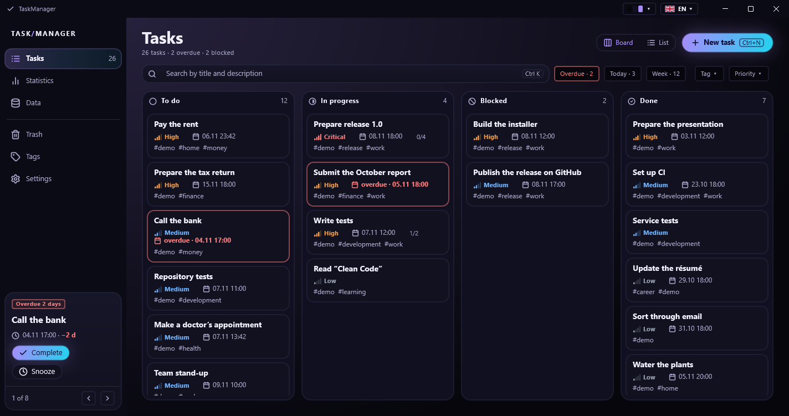
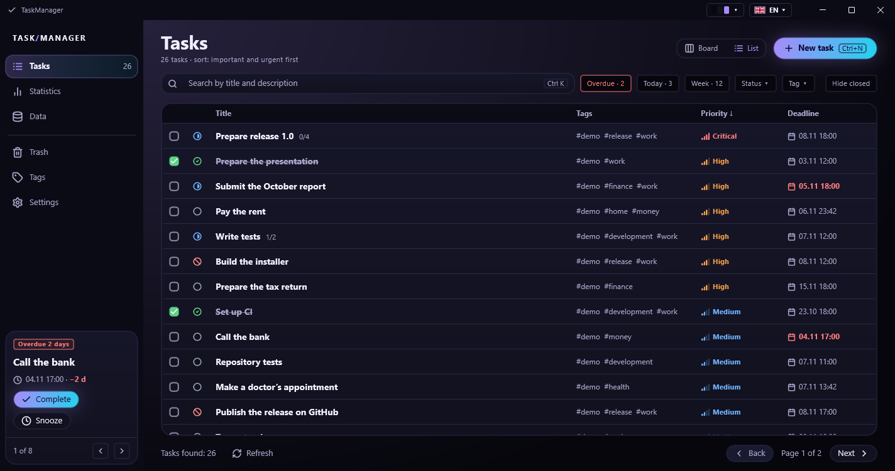
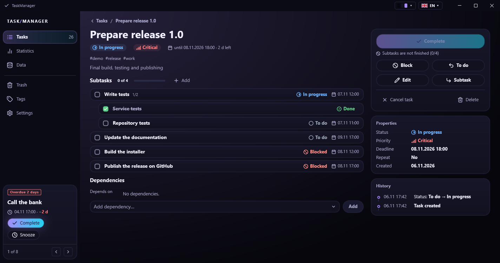
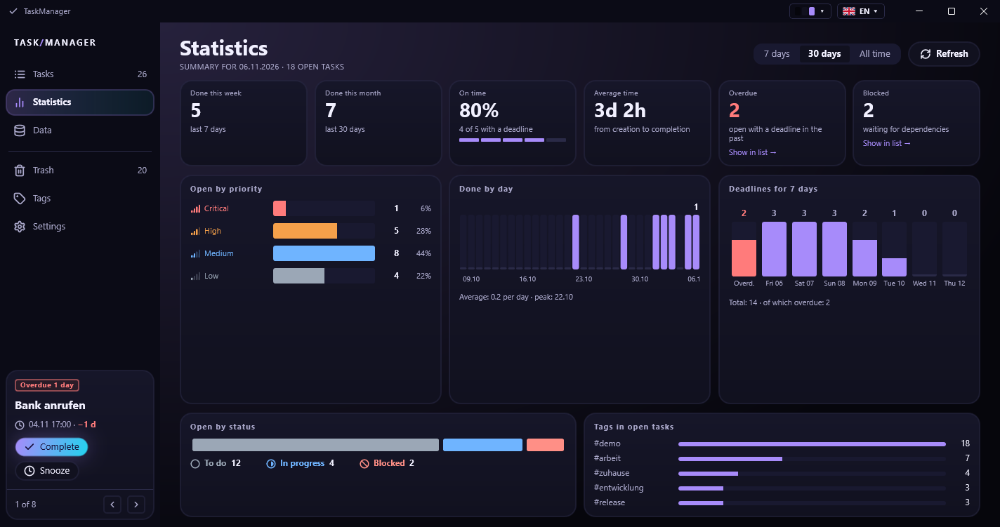
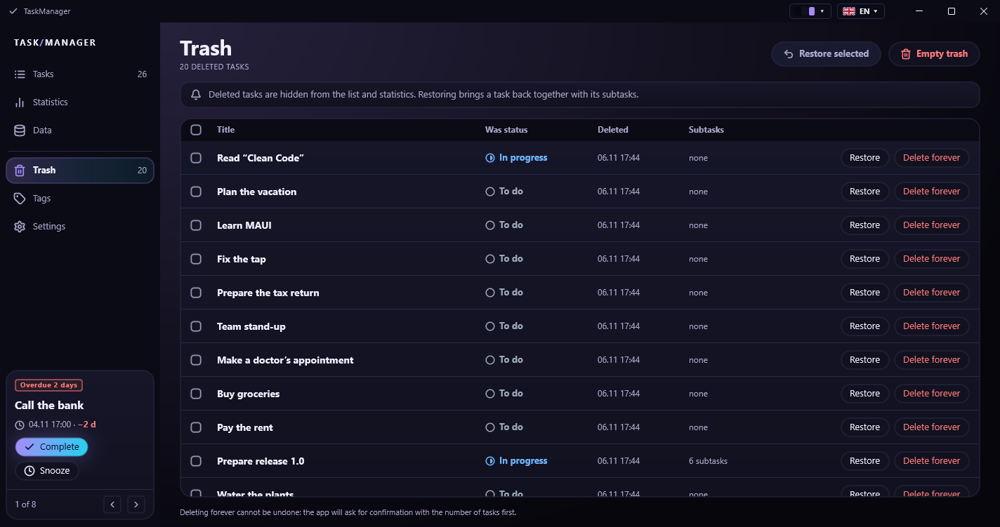
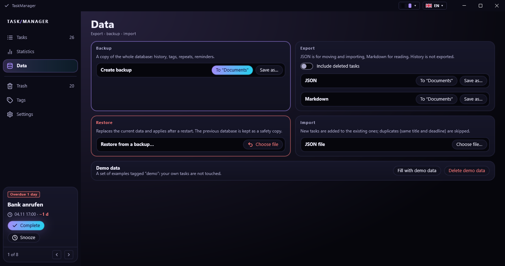
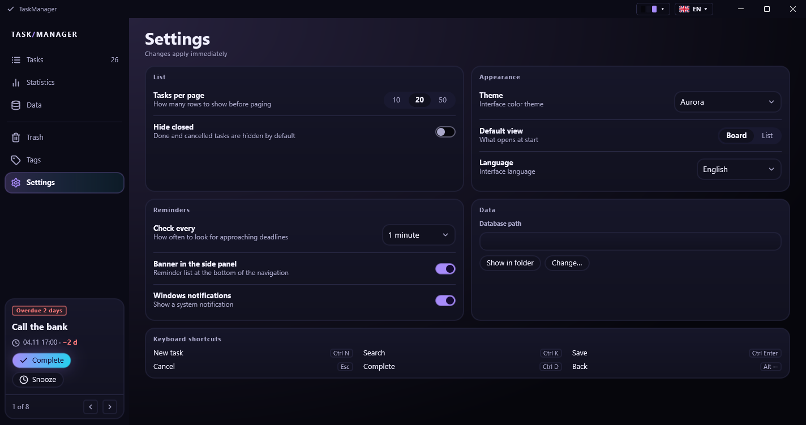
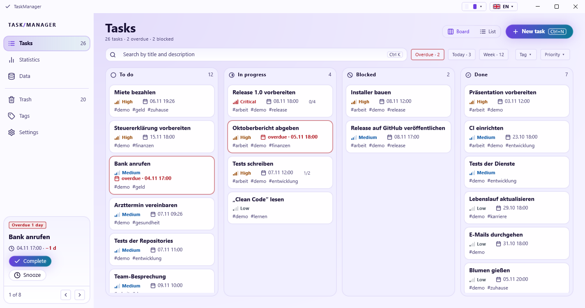
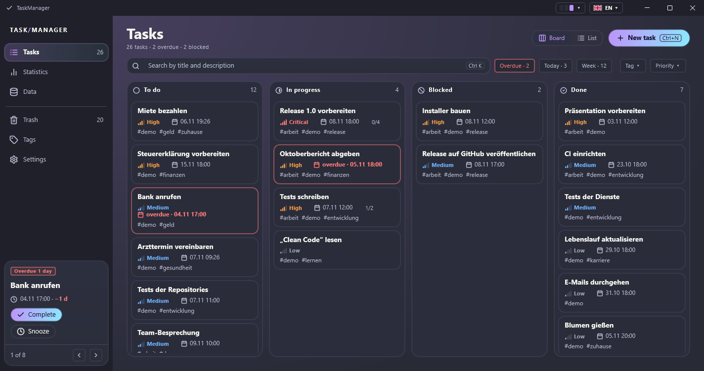
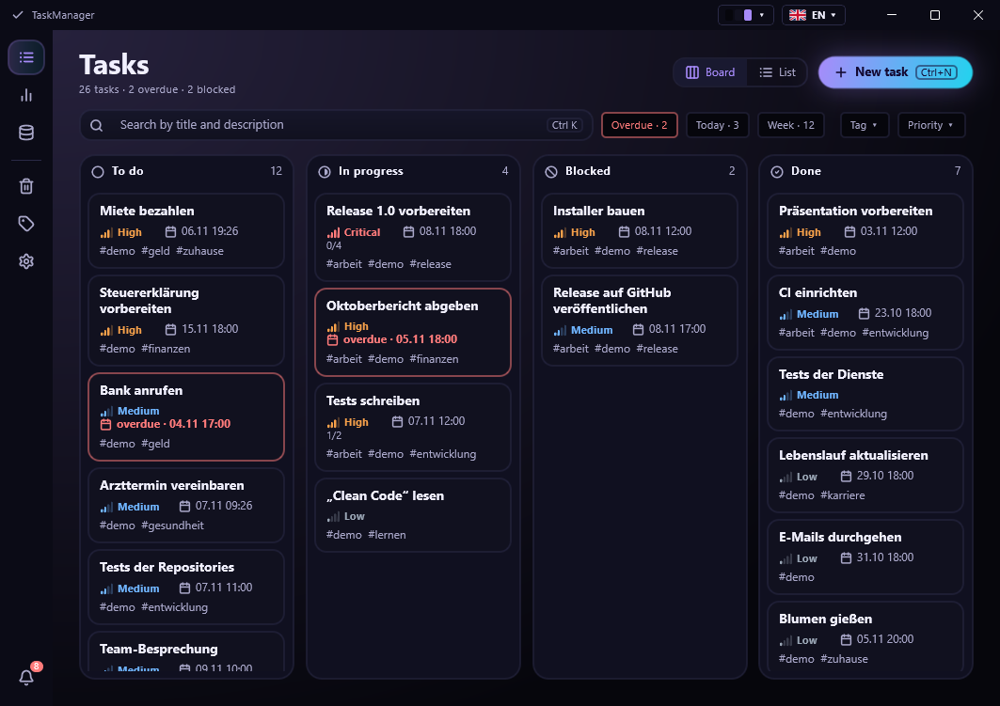

# TaskManager

[](https://github.com/BigJellyDog/TaskManager/actions/workflows/build.yml)

**English** · [Deutsch](README.de.md)

A personal task manager for Windows, built with **C#, .NET 10 and .NET MAUI**.
All data stays in a local SQLite file: no account, no server, no cloud.



## Highlights

- **Board and list** with search, quick filters (overdue / today / this week), filter by status, tag and
  priority, sorting by importance and urgency, paging.
- **Subtasks** up to three levels deep with a progress bar, and **dependencies** between tasks: a task that
  waits for another one is blocked, and cycles are rejected.
- **A strict status flow** (to do, in progress, blocked, done, cancelled) with a reopen action and a full
  **history** of every change on the task card.
- **Recurring tasks** (daily, weekly, monthly, yearly; every N, chosen weekdays) that repeat after completion
  or by the calendar, even for days the app was closed.
- **Reminders** 24 hours and 1 hour before a deadline and when it is overdue: the most urgent one in the side
  panel with *Complete* and *Snooze*, plus an optional Windows notification. The check interval is
  configurable, or off.
- **Trash** instead of deleting: restore with subtasks, delete forever, empty, select all.
- **Statistics** for 7 days, 30 days or all time: done by day, open tasks by priority and status, on-time rate,
  average completion time, deadlines for the next 7 days, top tags.
- **Your data stays yours**: JSON and Markdown export, JSON import with a detailed report, database backups with
  safe restore, demo data, and a button that moves the database to another folder.
- **Four languages** (English, German, Russian, Ukrainian) and **nine themes** (Aurora, Aurora Light, Dark,
  Light, Dracula, Nord, Gruvbox, Tokyo Night, Solarized Light, or follow Windows), switched at runtime.
- **Clean architecture**: a framework-free domain layer, an infrastructure layer for EF Core and SQLite,
  and an MVVM application layer. 190 automated tests.

## Screens

| | |
|---|---|
|  |  |
|  |  |
|  |  |

### Themes

| | | |
|---|---|---|
|  |  |  |
| Aurora Light | Dracula | Narrow window: the side panel folds into icons |

## Documentation

| Document | Content |
|----------|---------|
| [User guide](docs/en/USER_GUIDE.md) | every screen and workflow, shortcuts, data locations, backups |
| [Architecture](docs/en/ARCHITECTURE.md) | layers, data model, key design decisions, theming and localization |
| [Development](docs/en/DEVELOPMENT.md) | build, run, tests, migrations, conventions, how to extend |

The German versions are in [`docs/de`](docs/de).

## Requirements

- Windows 10 (version 1809) or 11, 64-bit
- [.NET 10 SDK](https://dotnet.microsoft.com/download)
- The .NET MAUI workload: `dotnet workload install maui`
- Optional: JetBrains Rider or Visual Studio 2022+ with the .NET MAUI workload

## Quick start (from source)

```powershell
dotnet run --project TaskManager.App -f net10.0-windows10.0.19041.0
```

Or open `TaskManager.sln` in Rider or Visual Studio, select `TaskManager.App` and run. The database is created
and upgraded automatically on the first start (`%LOCALAPPDATA%\TaskManager`). Open **Data → Fill with demo
data** to see every screen with sample tasks, and **Delete demo data** to remove them again.

Run the tests with:

```powershell
dotnet test TaskManager.Tests/TaskManager.Tests.csproj
```

## Technology

| Area | Choice |
|------|--------|
| Language / runtime | C# 14, .NET 10 |
| UI | .NET MAUI (Windows only), XAML, Shell navigation, MVVM with CommunityToolkit.Mvvm |
| Data | EF Core 10 + SQLite, code-first migrations |
| Drawing | own controls and `GraphicsView` (day chart, buttons, calendar, menus), Lucide icons; no chart library |
| Logging | Serilog to daily files |
| Tests | xUnit, SQLite in memory and temporary files |
| CI | GitHub Actions (build and test on `windows-latest`) |

## Project structure

| Project | Purpose |
|---------|---------|
| `TaskManager.Core` | domain model, services, specifications, export and import; knows nothing about EF Core or the UI |
| `TaskManager.Infrastructure` | EF Core and SQLite, migrations, repositories, backup and restore, the reminder background service |
| `TaskManager.App` | the .NET MAUI application: pages, view models, controls, theming, localization |
| `TaskManager.Tests` | unit and integration tests for Core and Infrastructure (and the translation tables) |

## License

MIT, see [LICENSE](LICENSE). Third-party components: [THIRD-PARTY-NOTICES.md](THIRD-PARTY-NOTICES.md).
