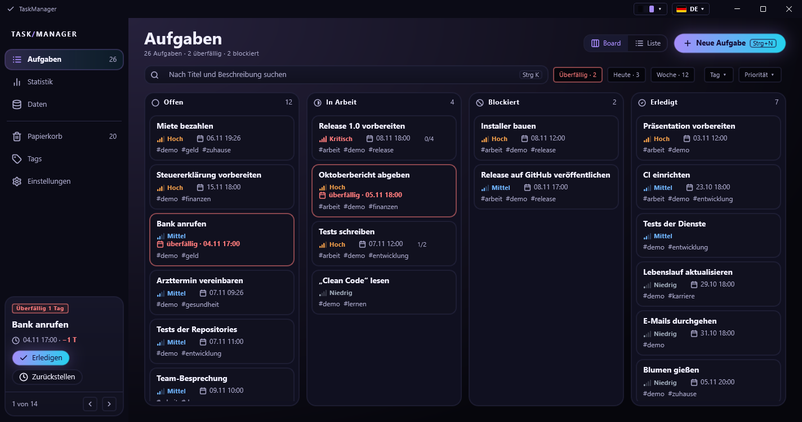
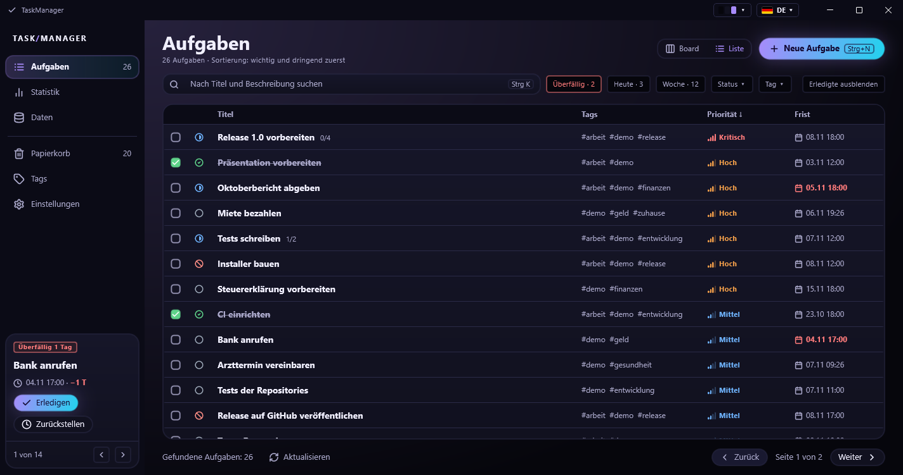
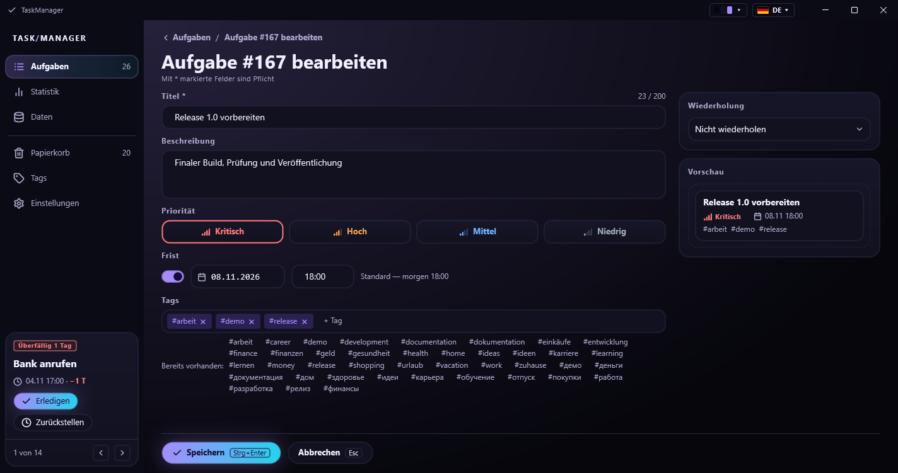
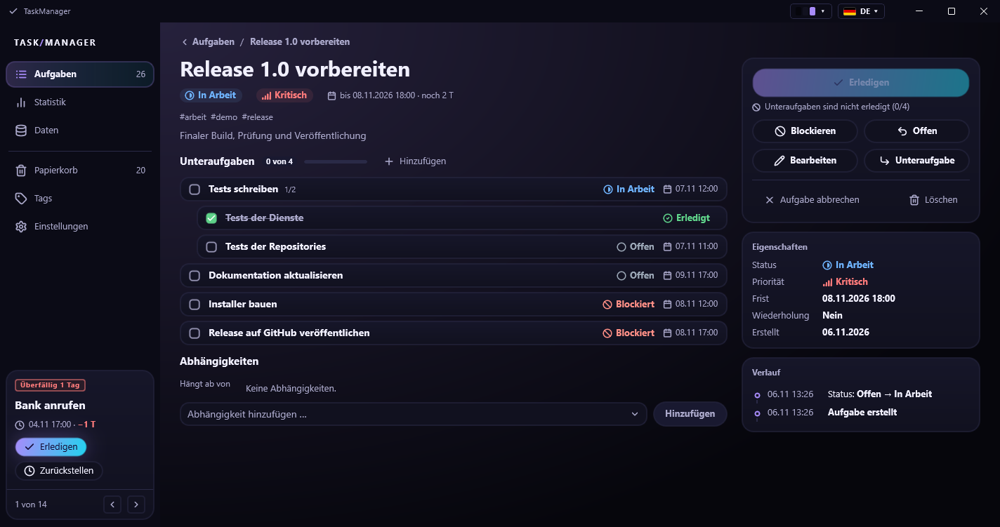
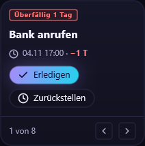
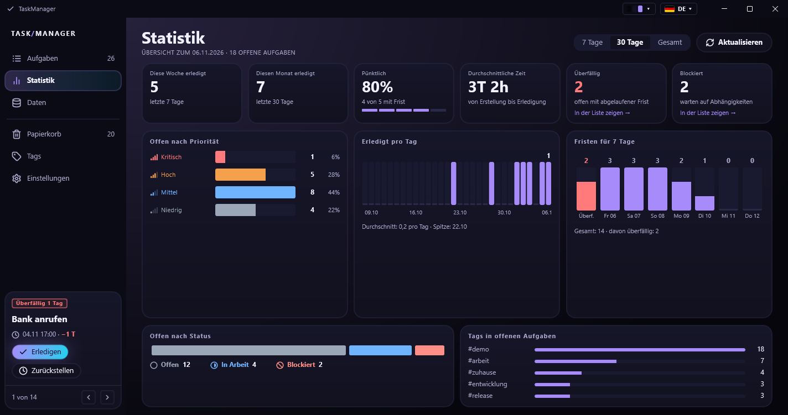
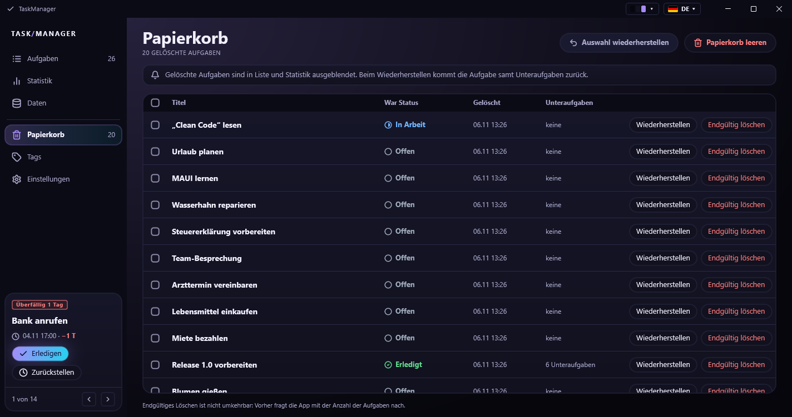
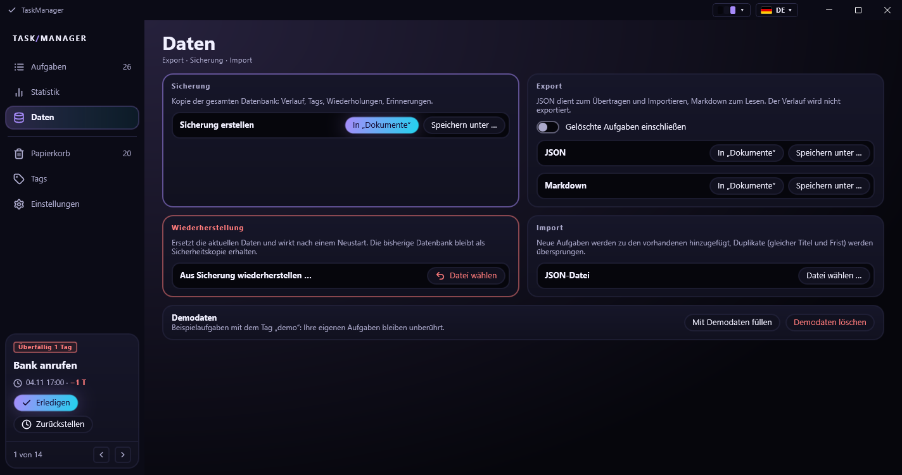
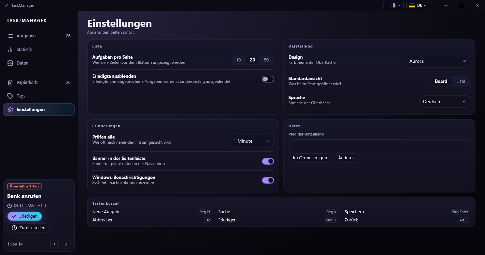

# Benutzerhandbuch

[Zurück zur README](../../README.de.md) · [English](../en/USER_GUIDE.md)

## Inhalt

1. [Orientierung](#1-orientierung)
2. [Aufgaben: Board und Liste](#2-aufgaben-board-und-liste)
3. [Aufgabe anlegen und bearbeiten](#3-aufgabe-anlegen-und-bearbeiten)
4. [Die Aufgabenkarte](#4-die-aufgabenkarte)
5. [Erinnerungen](#5-erinnerungen)
6. [Statistik](#6-statistik)
7. [Papierkorb](#7-papierkorb)
8. [Tags](#8-tags)
9. [Daten: Export, Import, Sicherung](#9-daten-export-import-sicherung)
10. [Einstellungen](#10-einstellungen)
11. [Ihre Daten](#11-ihre-daten)
12. [Problemlösung](#12-problemlösung)

## 1. Orientierung

Die Seitenleiste links listet die Bereiche: **Aufgaben**, **Statistik**, **Daten**, **Papierkorb**, **Tags** und
**Einstellungen**. Die Zahl neben *Aufgaben* ist die Zahl der offenen Aufgaben, die Zahl neben *Papierkorb* die der
gelöschten. Ist das Fenster schmaler als etwa 1100 Pixel, klappt die Leiste zu Symbolen zusammen, und die
Erinnerungen verschwinden hinter einem Glockensymbol.

Oben rechts im Fenster stehen die Farbvorschau des aktuellen Designs und die Sprachschaltfläche. Beide öffnen eine
Liste; die Auswahl gilt sofort.

| Tastenkürzel | Aktion |
|--------------|--------|
| `Strg+1` … `Strg+6` | zu einem Bereich wechseln |
| `Strg+N` | neue Aufgabe |
| `Strg+K` | zum Suchfeld springen |
| `Strg+Enter` | Formular speichern |
| `Esc` | Formular abbrechen |
| `Strg+D` | Aufgabe auf ihrer Karte erledigen |
| `Alt+←` | zurück |

## 2. Aufgaben: Board und Liste

Das **Board** zeigt vier Spalten: *Offen*, *In Arbeit*, *Blockiert*, *Erledigt*. Jede Karte zeigt Titel, Priorität,
Frist (rot und mit dem Wort *überfällig*, wenn sie verstrichen ist), den Fortschritt der Unteraufgaben und die
Tags. Die **Liste** ist eine Tabelle mit denselben Angaben, einem Kästchen zum Erledigen, einem farbigen
Statussymbol und Seitenwechsel (10, 20 oder 50 Zeilen pro Seite, siehe Einstellungen).

Über dem Inhalt lässt sich die Auswahl eingrenzen:

- Die **Suche** (`Strg+K`) durchsucht Titel und Beschreibung.
- **Überfällig**, **Heute** und **Woche** sind Schnellfilter mit der Zahl der passenden Aufgaben. Ein zweiter Klick
  schaltet den Filter wieder aus.
- **Status**, **Tag** und **Priorität** öffnen eine Liste mit einem Wert zur Auswahl.
- **Erledigte ausblenden** blendet erledigte und abgebrochene Aufgaben aus (Listenansicht; die Voreinstellung
  steht in den Einstellungen).

Die Liste ist nach Wichtigkeit und Dringlichkeit sortiert (erst die Priorität, dann die Frist). Die
Spaltenköpfe ändern die Reihenfolge: **Titel** sortiert A–Z, **Frist** stellt die nächste nach vorn, **Priorität**
kehrt zur Standardsortierung zurück.

## 3. Aufgabe anlegen und bearbeiten

Klicken Sie auf **Neue Aufgabe** (`Strg+N`). Mit `*` markierte Felder sind Pflicht.

- **Titel** (bis 200 Zeichen) und **Beschreibung** (bis 4000).
- **Priorität**: Kritisch, Hoch, Mittel, Niedrig.
- **Frist**: einschalten, im Kalender ein Datum wählen und eine Uhrzeit eingeben. Voreingestellt ist morgen um
  18:00 Uhr.
- **Tags**: einen Namen tippen und Enter drücken; bereits verwendete Tags werden darunter vorgeschlagen, ein Klick
  fügt sie hinzu.
- **Wiederholung** (rechte Spalte): aus oder täglich / wöchentlich / monatlich / jährlich, alle *N*
  Tage/Wochen/Monate/Jahre, bei wöchentlicher Wiederholung die Wochentage, und der Modus: *nach dem Erledigen*
  erzeugt die nächste Kopie, wenn Sie die Aufgabe abschließen, *nach Kalender* erzeugt sie planmäßig, auch wenn die
  vorige noch offen ist. Tage, an denen die App geschlossen war, werden beim nächsten Start nachgeholt.
- Die **Vorschau** zeigt, wie die Karte aussehen wird.

## 4. Die Aufgabenkarte

Ein Klick auf eine Aufgabe öffnet ihre Karte.

- Die große Schaltfläche rechts bringt die Aufgabe voran (*Starten*, dann *Erledigen*). Ist sie blass, steht der
  Grund darunter, zum Beispiel *Unteraufgaben sind nicht erledigt (0/4)* oder eine offene Abhängigkeit.
- Weitere Schaltflächen: *Blockieren*, *Offen*, *Bearbeiten*, *Unteraufgabe*, *Aufgabe abbrechen* und *Löschen*
  (verschiebt in den Papierkorb). Eine erledigte oder abgebrochene Aufgabe bietet stattdessen *Wieder öffnen*.
- **Statusablauf**: Offen → In Arbeit → Erledigt; eine Aufgabe kann blockiert und zu *Offen* zurückgesetzt werden;
  aus jedem offenen Status kann sie abgebrochen werden. Eine erledigte Aufgabe wird zu *In Arbeit* wieder
  geöffnet, eine abgebrochene zu *Offen*.
- **Unteraufgaben** lassen sich bis zu drei Ebenen tief verschachteln. Eine Aufgabe kann nicht erledigt werden,
  solange eine Unteraufgabe offen ist. **Hinzufügen** legt eine Unteraufgabe an, ein Klick auf eine Unteraufgabe
  öffnet sie.
- **Abhängigkeiten**: *Hängt ab von* nennt die Aufgaben, die zuerst erledigt sein müssen. Aufgabe in der Liste
  wählen und **Hinzufügen** klicken. Eine Aufgabe mit unerledigter Abhängigkeit ist automatisch blockiert und wird
  freigegeben, sobald die Abhängigkeit erledigt ist. Eine Abhängigkeit, die einen Zyklus bilden würde, wird
  abgelehnt.
- **Eigenschaften** und **Verlauf**: Jede Änderung (Status, Titel, Frist, Tags, übergeordnete Aufgabe,
  Abhängigkeiten) wird mit Uhrzeit festgehalten.

Hat jemand die Aufgabe geändert, während Sie sie bearbeitet haben, weist die App darauf hin und zeigt den
aktuellen Stand.

## 5. Erinnerungen

Eine Erinnerung erscheint **24 Stunden** und **1 Stunde** vor einer Frist und sobald die Aufgabe **überfällig** ist.
Die dringendste steht unten in der Seitenleiste:

*Erledigen* schließt die Aufgabe ab, *Zurückstellen* zeigt die nächste Erinnerung (die Aufgabe bleibt in der Liste),
die Pfeile und *1 von 8* wechseln zwischen ihnen. Bei jedem Start der App erscheinen die noch aktuellen
Erinnerungen erneut. Sind die **Windows-Benachrichtigungen** an (Einstellungen), wird die dringendste Erinnerung
zusätzlich als Systembenachrichtigung gezeigt.

## 6. Statistik

Oben wählen Sie **7 Tage**, **30 Tage** oder **Gesamt**. Die sechs Kacheln zeigen, was in der letzten Woche und im
letzten Monat erledigt wurde, den Anteil der fristgerecht erledigten Aufgaben, die durchschnittliche Zeit von der
Erstellung bis zum Erledigen sowie die überfälligen und blockierten Aufgaben (mit einem Link zur gefilterten
Liste). Darunter stehen die offenen Aufgaben nach Priorität und Status, das Diagramm **Erledigt pro Tag** (die
letzten 7 oder 30 Tage), die Fristen der nächsten 7 Tage und die häufigsten Tags.

## 7. Papierkorb

*Löschen* auf einer Karte verschiebt die Aufgabe samt Unteraufgaben in den Papierkorb. Sie verschwinden aus Liste,
Board und Statistik. Im Papierkorb gilt:

- **Wiederherstellen** bringt eine Aufgabe samt Unteraufgaben zurück.
- **Endgültig löschen** entfernt die Aufgabe und ihre Unteraufgaben für immer, nach einer Rückfrage mit der Anzahl.
- Das Kästchen in der Kopfzeile wählt alles aus; **Auswahl wiederherstellen** und **Papierkorb leeren** wirken auf
  die Auswahl oder auf alles.

## 8. Tags

Die Tabelle listet jeden Tag mit der Zahl der Aufgaben, die ihn verwenden. **Umbenennen** ändert den Tag in allen
Aufgaben (ein bereits vorhandener Name wird abgelehnt), **Löschen** geht nur bei Tags, die keine Aufgabe nutzt.
Das Suchfeld filtert die Tabelle.

## 9. Daten: Export, Import, Sicherung

- **Sicherung**: eine Kopie der gesamten Datenbank (Verlauf, Tags, Wiederholungen, Erinnerungen). *In „Dokumente“*
  speichert sie in `Dokumente\TaskManager`, *Speichern unter …* lässt Sie den Ort wählen.
- **Wiederherstellung**: Sicherungsdatei wählen. Die App prüft, ob es eine gültige TaskManager-Datenbank ist,
  nennt die Zahl der enthaltenen Aufgaben und wendet sie nach Ihrer Bestätigung beim nächsten Start an. Die bisherige
  Datenbank bleibt daneben als Sicherheitskopie erhalten (`*.before-restore-….bak`).
- **Export**: JSON (zum Übertragen und Importieren) oder Markdown (zum Lesen, in der Sprache der Oberfläche).
  Der Schalter nimmt gelöschte Aufgaben mit. Der Verlauf wird nicht exportiert.
- **Import**: eine JSON-Datei wählen. Neue Aufgaben werden hinzugefügt; eine Aufgabe mit gleichem Titel und gleicher
  Frist wie eine vorhandene wird übersprungen. Ein Bericht zeigt, wie viele Aufgaben hinzugefügt, übersprungen
  wurden, fehlgeschlagen sind oder eine Warnung ausgelöst haben, mit einer Zeile je Fall.
- **Demodaten**: fügt etwa 25 Beispielaufgaben mit dem Tag `demo` hinzu (ein Projekt mit Unteraufgaben und
  Abhängigkeiten, überfällige und bevorstehende Fristen, Wiederholungen, erledigte Aufgaben mit Verlauf).
  *Demodaten löschen* verschiebt sie in den Papierkorb. Ihre eigenen Aufgaben bleiben unberührt.

## 10. Einstellungen

| Einstellung | Bedeutung |
|-------------|-----------|
| Aufgaben pro Seite | 10, 20 oder 50 Zeilen in der Liste |
| Erledigte ausblenden | erledigte und abgebrochene Aufgaben standardmäßig ausblenden |
| Design | System, Aurora, Aurora Hell, Dunkel, Hell, Dracula, Nord, Gruvbox, Tokio Nacht, Solarized Hell |
| Standardansicht | Board oder Liste: was beim Start geöffnet wird |
| Sprache | English, Deutsch, Русский, Українська |
| Prüfen alle | 1, 5, 15 oder 30 Minuten oder **Nie** (keine Fristerinnerungen) |
| Banner in der Seitenleiste | den Erinnerungsblock anzeigen |
| Windows-Benachrichtigungen | zusätzlich eine Systembenachrichtigung zeigen |
| Pfad der Datenbank | wo die Datenbankdatei liegt; **Im Ordner zeigen** öffnet ihn, **Ändern…** verschiebt sie |

Änderungen gelten sofort. Beim Wechsel von Design oder Sprache wird das Fenster mit demselben geöffneten Bereich neu
aufgebaut.

**Ändern…** fragt nach einem Ordner, legt dort eine konsistente Kopie der Datenbank ab, merkt sich den neuen Ort und
startet die App neu. Die alte Datei bleibt, wo sie war; löschen Sie sie selbst, wenn Sie sie nicht mehr brauchen.
Wer zum Standardordner zurückwill, löscht `database-location.txt` (siehe unten).

## 11. Ihre Daten

| Was | Wo |
|-----|----|
| Datenbank | `%LOCALAPPDATA%\TaskManager\taskmanager.db` (oder der unter *Ändern…* gewählte Ordner) |
| Einstellungen | `%LOCALAPPDATA%\TaskManager\settings.json` |
| Verweis auf den Datenbankordner | `%LOCALAPPDATA%\TaskManager\database-location.txt` (nur nach *Ändern…*) |
| Protokolle | `%LOCALAPPDATA%\TaskManager\logs\taskmanager-JJJJMMTT.log` (die letzten 14 Tage) |
| Exporte und Sicherungen | `Dokumente\TaskManager` |

Alles bleibt lokal; die App verbindet sich nicht mit dem Internet.

## 12. Problemlösung

- **Das Fenster öffnet sich hinter anderen Fenstern.** Die App bittet Windows beim Start, sie nach vorn zu holen.
  Lehnt Windows das ab (das passiert manchmal bei Programmen, die von einem anderen Programm gestartet wurden),
  klicken Sie auf ihr Symbol in der Taskleiste.
- **Eine Aufgabe lässt sich nicht erledigen.** Lesen Sie die Zeile unter der Schaltfläche: unerledigte
  Unteraufgaben oder Abhängigkeiten.
- **Eine Sicherung oder ein Import wird abgelehnt.** Die Meldung nennt den Grund (keine Datenbank, neuere Version,
  beschädigte Datei).
- **Keine Erinnerungen.** Prüfen Sie *Prüfen alle* in den Einstellungen (nicht *Nie*) und ob die Aufgabe eine Frist
  innerhalb von 24 Stunden hat, offen ist und nicht im Papierkorb liegt.
- **Nach einem Update wirkt etwas falsch.** Schließen Sie die App, kopieren Sie `taskmanager.db` an einen sicheren
  Ort und starten Sie sie erneut; die Datenbank wird automatisch aktualisiert. Das Protokoll in `logs` enthält die
  Einzelheiten.
