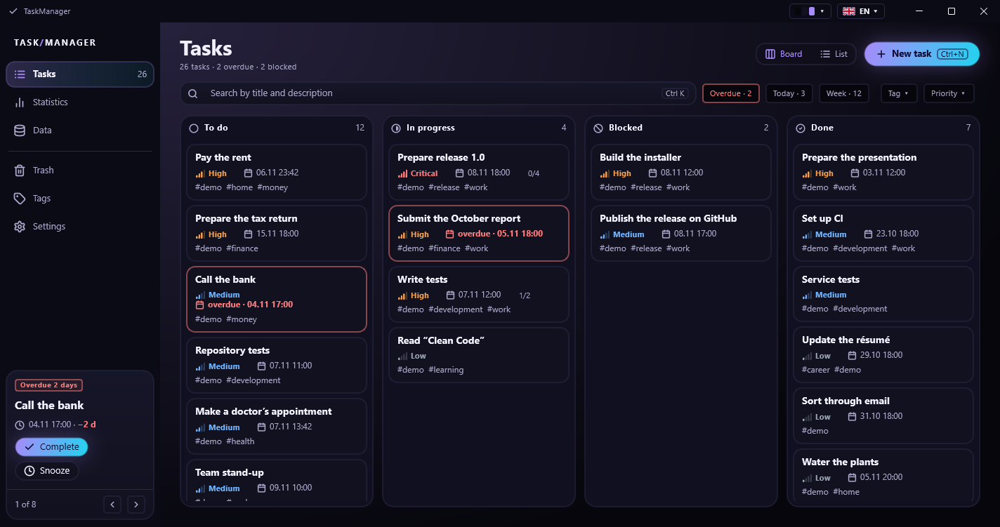
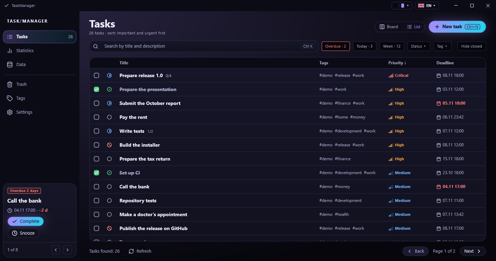
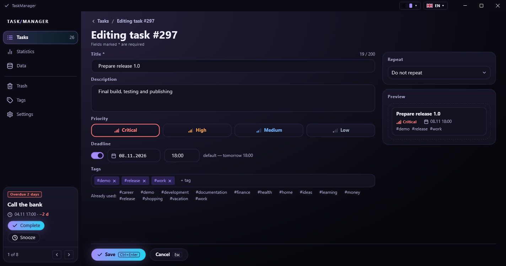
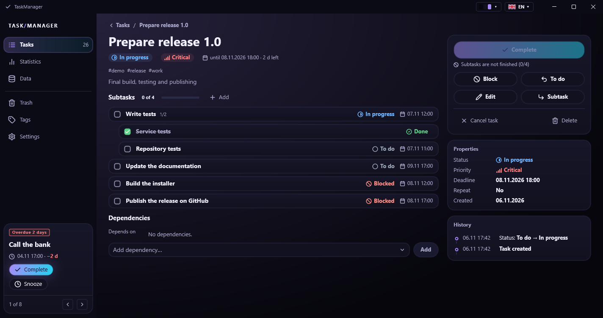
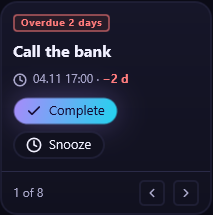
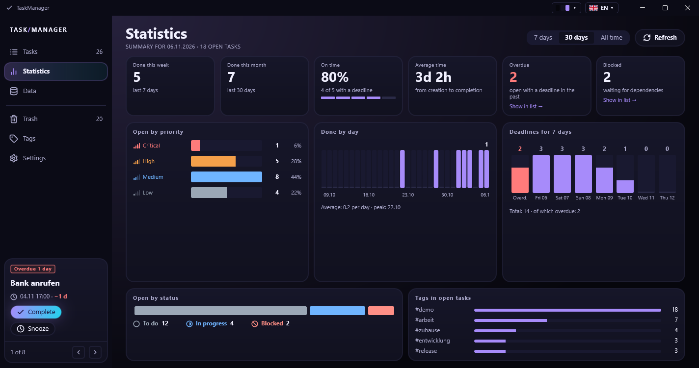
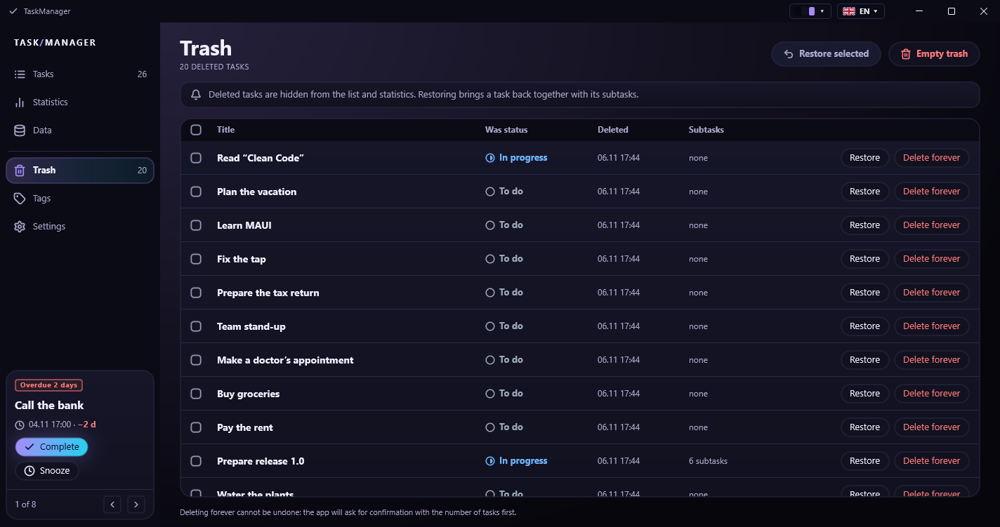
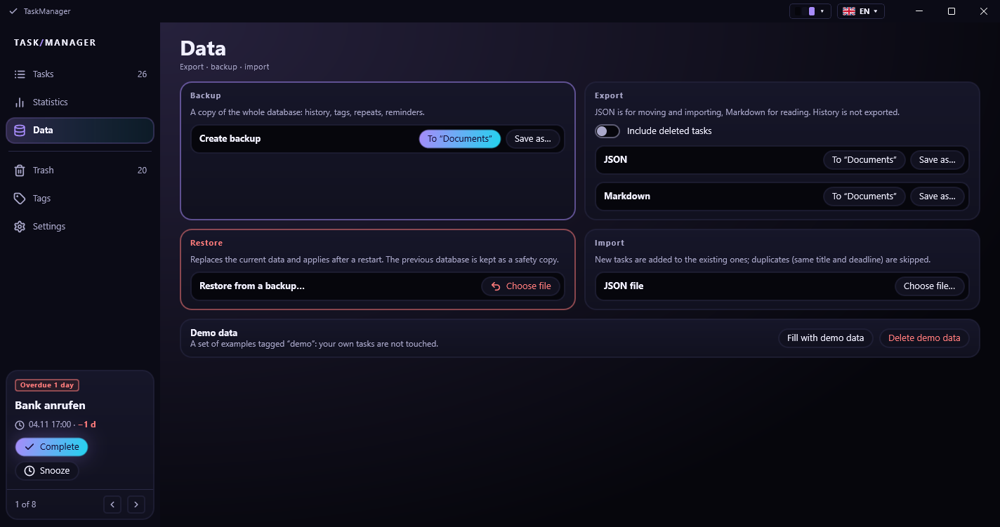
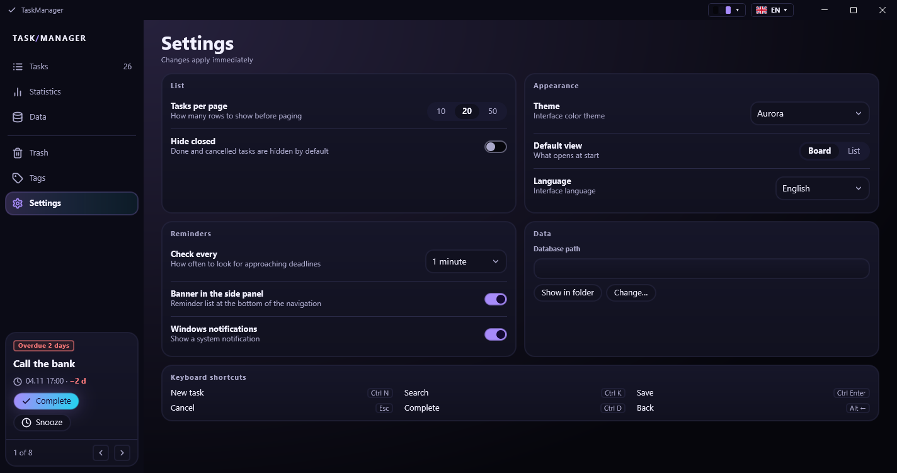

# User guide

[Back to README](../../README.md) · [Deutsch](../de/BENUTZERHANDBUCH.md)

## Contents

1. [Getting around](#1-getting-around)
2. [Tasks: board and list](#2-tasks-board-and-list)
3. [Creating and editing a task](#3-creating-and-editing-a-task)
4. [The task card](#4-the-task-card)
5. [Reminders](#5-reminders)
6. [Statistics](#6-statistics)
7. [Trash](#7-trash)
8. [Tags](#8-tags)
9. [Data: export, import, backup](#9-data-export-import-backup)
10. [Settings](#10-settings)
11. [Your data](#11-your-data)
12. [Troubleshooting](#12-troubleshooting)

## 1. Getting around

The side panel on the left lists the sections: **Tasks**, **Statistics**, **Data**, **Trash**, **Tags** and
**Settings**. The number next to *Tasks* is the number of open tasks, the number next to *Trash* the number of
deleted ones. When the window is narrower than about 1100 pixels the panel folds into icons and the reminders
move behind a bell icon.

At the top right of the window are the theme preview (the three colours of the current theme) and the language
button. Both open a list; the choice applies at once.

| Shortcut | Action |
|----------|--------|
| `Ctrl+1` … `Ctrl+6` | go to a section |
| `Ctrl+N` | new task |
| `Ctrl+K` | jump to the search field |
| `Ctrl+Enter` | save the form |
| `Esc` | cancel the form |
| `Ctrl+D` | complete the task on its card |
| `Alt+←` | back |

## 2. Tasks: board and list

**Board** shows four columns: *To do*, *In progress*, *Blocked*, *Done*. Each card shows the title, the
priority, the deadline (red and with the word *overdue* when it has passed), the subtask progress and the tags.
**List** is a table with the same information, a checkbox to complete a task, a coloured status icon, and
paging (10, 20 or 50 rows per page, see Settings).

Above the content you can narrow things down:

- **Search** (`Ctrl+K`) looks in the title and the description.
- **Overdue**, **Today** and **Week** are quick filters with the number of matching tasks. Click one again to
  switch it off.
- **Status**, **Tag** and **Priority** open a list to pick one value.
- **Hide closed** hides done and cancelled tasks (list view; the default can be set in Settings).

The list is sorted by importance and urgency (priority first, then the deadline). The column headers change the
order: **Title** sorts A–Z, **Deadline** puts the nearest first, **Priority** returns to the default.

## 3. Creating and editing a task

Click **New task** (`Ctrl+N`). Fields marked with `*` are required.

- **Title** (up to 200 characters) and **Description** (up to 4000).
- **Priority**: Critical, High, Medium, Low.
- **Deadline**: switch it on, pick a date in the calendar and enter a time. The default is tomorrow at 18:00.
- **Tags**: type a name and press Enter; the tags already in use are suggested below, click one to add it.
- **Repeat** (right column): off, or daily / weekly / monthly / yearly, every *N* days/weeks/months/years, for
  weekly repeats the weekdays, and the mode: *after completion* creates the next copy when you finish the task,
  *by calendar* creates it on schedule even if the previous one is still open. Days the app was closed are caught
  up the next time it starts.
- The **Preview** shows how the card will look.

## 4. The task card

Click a task to open its card.

- The big button on the right moves the task forward (*Start*, then *Complete*). If it is grey, the reason is
  written under it, for example *Subtasks are not finished (0/4)* or an unmet dependency.
- Further buttons: *Block*, *To do*, *Edit*, *Subtask*, *Cancel task* and *Delete* (moves to the trash). A done
  or cancelled task offers *Reopen* instead.
- **Status flow**: To do → In progress → Done; a task can be blocked and returned to *To do*; it can be
  cancelled from any open status. A done task is reopened to *In progress*, a cancelled one to *To do*.
- **Subtasks** can be nested up to three levels deep. A task cannot be completed while a subtask is open.
  Click **Add** to create a subtask, click a subtask to open it.
- **Dependencies**: *Depends on* lists the tasks that must be done first. Pick a task in the list and click
  **Add**. A task with an unfinished dependency is blocked automatically and is released when the dependency is
  done. A dependency that would create a cycle is rejected.
- **Properties** and **History**: every change (status, title, deadline, tags, parent, dependencies) is
  recorded with its time.

If somebody else changed the task while you were editing it, the app says so and shows the current data.

## 5. Reminders

A reminder appears **24 hours** and **1 hour** before a deadline and once the task is **overdue**. The most
urgent one is shown at the bottom of the side panel:

*Complete* finishes the task, *Snooze* shows the next reminder (the task stays in the list), the arrows and
*1 of 8* switch between them. Every time the app starts, the reminders that are still relevant appear again.
With **Windows notifications** on (Settings) the most urgent reminder is also shown as a system notification.

## 6. Statistics

Choose **7 days**, **30 days** or **All time** at the top. The six tiles show what was done in the last week and
month, the share of tasks done by their deadline, the average time from creation to completion, and the overdue
and blocked tasks (with a link to the filtered list). Below are open tasks by priority and status, the **Done by
day** chart (the last 7 or 30 days), the deadlines of the next 7 days and the most used tags.

## 7. Trash

*Delete* on a card moves the task, with its subtasks, to the trash. They disappear from the list, the board and
the statistics. In the trash:

- **Restore** brings a task back together with its subtasks; a subtask needs its parent to be restored first.
- **Delete forever** removes the task and its subtasks for good, after a confirmation with the count.
- The checkbox in the header selects all; **Restore selected** and **Empty trash** work on the selection or
  on everything.

## 8. Tags

The table lists every tag with the number of tasks that use it. **Rename** changes the tag in all tasks (a name
that already exists is refused), **Delete** works only for tags that no task uses. The search field filters the
table.

To clear many unused tags at once, tick their check boxes (only unused tags have one), or tick the box in the table
header to select all of them. Hold **Shift** and click a second check box to select everything in between, then press
**Delete selected**.

## 9. Data: export, import, backup

- **Backup**: a copy of the whole database (history, tags, repeats, reminders). *To "Documents"* saves it to
  `Documents\TaskManager`, *Save as…* lets you choose the place.
- **Restore**: pick a backup file. The app checks that it is a valid TaskManager database, tells you how many
  tasks it holds and, after you confirm, applies it at the next start. The previous database is kept next to
  it as a safety copy (`*.before-restore-….bak`).
- **Export**: JSON (for moving and importing) or Markdown (for reading, in the interface language). The switch
  adds deleted tasks. The history is not exported.
- **Import**: pick a JSON file. New tasks are added; a task with the same title and deadline as an existing one
  is skipped. A report shows how many tasks were added, skipped, failed and warned about, with a line for each.
- **Demo data**: adds about 25 sample tasks tagged `demo` (a project with subtasks and dependencies, overdue and
  upcoming deadlines, repeats, finished tasks with history). *Delete demo data* moves them to the trash. Your
  own tasks are never touched.

## 10. Settings

| Setting | Meaning |
|---------|---------|
| Tasks per page | 10, 20 or 50 rows in the list |
| Hide closed | hide done and cancelled tasks by default |
| Theme | System, Aurora, Aurora Light, Dark, Light, Dracula, Nord, Gruvbox, Tokyo Night, Solarized Light |
| Default view | Board or List: what opens at start |
| Language | English, Deutsch, Русский, Українська |
| Check every | 1, 5, 15 or 30 minutes, or **Never** (no deadline reminders) |
| Banner in the side panel | show the reminder block |
| Windows notifications | also show a system notification |
| Database path | where the database file lives; **Show in folder** opens it, **Change…** moves it |

Changes apply immediately. Switching the theme or the language rebuilds the window with the same section open.

**Change…** asks for a folder, copies a consistent copy of the database there, remembers the new place and
restarts the app. The old file stays where it was; delete it yourself when you no longer need it. Remove
`database-location.txt` (see below) to go back to the default folder.

## 11. Your data

| What | Where |
|------|-------|
| Database | `%LOCALAPPDATA%\TaskManager\taskmanager.db` (or the folder chosen under *Change…*) |
| Settings | `%LOCALAPPDATA%\TaskManager\settings.json` |
| Database folder pointer | `%LOCALAPPDATA%\TaskManager\database-location.txt` (only after *Change…*) |
| Logs | `%LOCALAPPDATA%\TaskManager\logs\taskmanager-YYYYMMDD.log` (the last 14 days) |
| Exports and backups | `Documents\TaskManager` |

Everything is local; the app does not connect to the internet.

## 12. Troubleshooting

- **The window opens behind other windows.** The app asks Windows to bring it to the front when it starts. If
  Windows refuses (it sometimes does for programs started from another program), click its icon in the taskbar.
- **A task cannot be completed.** Read the line under the button: unfinished subtasks or dependencies.
- **A backup or an import is rejected.** The message says why (not a database, newer version, damaged file).
- **No reminders.** Check *Check every* in Settings (not *Never*) and that the task has a deadline within 24
  hours, is open and is not in the trash.
- **Something looks wrong after an update.** Close the app, copy `taskmanager.db` somewhere safe and start it
  again; the database is upgraded automatically. The log in `logs` has the details.
